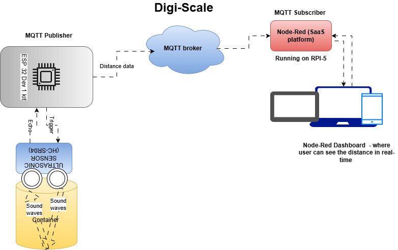
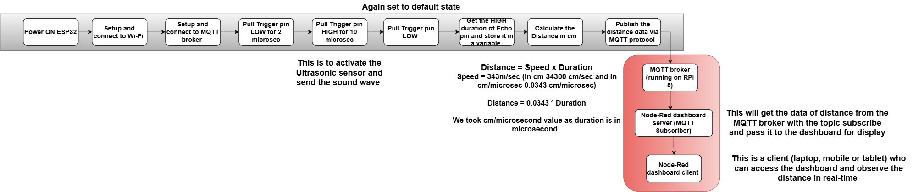

# Digi-scale
Digi-scale is used to monitor and give the alerts when scale value is beyond threshold in real-time

It is IoT based system that can measure Length/Height/Width of the product or object and send it to the dashboard server via MQTT protocol in real-time.

## Observations

There are many observations in your day to day life that would tell you why this project is useful : 

### Observation 1 
> #### Re-filling the Water clay pot (Matka) from water filter takes time so, user started scrolling the reels or doing other work in parallel but the Pot get overflow and whole platform is full of water so, this is wasteage of water that I observed.
> #### If user can put the Digi-scale on top of the Pot then it can give alert to the user to turn OFF the water flow.

### Observation 2
> #### When suddenly guests comes to user's home and spices or veggies stocks are empty , nothing is there and also even if in quick commerce apps it is not available. So, I observed here that we have re-stock the things before it got empty. 
> #### if the Digi-scale device gives you an alert before time and you can re-stock the houshold kitchen products it would be easy in above situtions.

### Observation 3

> #### When you are travelling and your home is in the  renovation phase so, while choosing the size of the products like tiles, asthetic images, decorative things and customize furniture etc so, I observed her it takes lots of time in video calls
> #### if the contractor uses the Digi-Scale for meauring size of products so, the owner can see the dashboard directly for size purpose and we can also store it for future use.

### In addtion to above three observation , there are lots of observation you did see in your daily life

## Overview of the project

#### This project is very simple and easy to understand. 
#### Basically it is a IoT based scale that can measure the Length, Height and width of any product via Ultrasonic sensor and send the data to Dashboard server via MQTT in real-time.

#### If the measurable parameters is beyond the certain thresold, it can send the alert message to telegram messanger via MQTT protocal and Telegram APIs.

#### This project automate the way of monitering the Length, Width and Height of the product and also the  ingredaints quantity that is inside of the measurable container. 

## Techincal details 

### Architecture Block Diagram

### Hardware components

>1. ESP32 Dev 1 Kit
>2. Ultrasonic Sensor (HC-SR04)
>3. Breadboard to connect ESP32 and Ultrasonic sensor
>4. Raspberry PI 5

### Software components 

>1. MQTT broker 
>2. Node-Red platform for dashboard server and MQTT subscriber
>3. ESP32 Firmware that measures distance and send data to broker

### System flow (ESP32 -> Dashboard)

## Bring-up Steps 

### Pre-requist Steps : 
#### 1. **Install Platform IO IDE extention in VScode or used the Arduino IDE** - As this IDEs has the board libs and dependances.
#### 2. **Install Node-Red SaaS platform** refer **[Steps](https://nodered.org/docs/getting-started/raspberrypi)** - On PI
#### 3. **Install the MQTT broker** refer **[Steps](https://randomnerdtutorials.com/how-to-install-mosquitto-broker-on-raspberry-pi/)** - On PI

### ESP 32 FW Steps : 
> #### The steps is same as Digital switch repo, please refer that steps [Here](https://github.com/vyomchanpura/Digital_Switch/blob/main/Bring_up_Doc/Digital_Switch_ESP32_FW_bringup.md#digital-switch---esp32-firmware), just take the source code for this project from [here]().

### Node-Red Setup on PI 
#### 1. Install the Node-Red in PI as mentioned in Pre-requist steps
#### 2. Open the web-interface of node-red for development in the browser
#### 3. Install the UI-dashboard and MQTT pallet by going to the 3 line at right corner --> Manage pallete --> Install 
#### 4. Import the flow file (download it from [here](Linkofnode-redflow)) of this project by going to 3 line at right corner --> import and select the flow file.
#### 5. Deploy the flow by clicking the deploy button in the web-interface in the node-red server 
#### 5. Open the dashboard UI with the URL : **<IPofnode-red_server>:port/ui** 
#### 6. User can see the real-time distance of an object on to the dashboard.
 
#### So, now systems are up with FW in ESP32 board, MQTT broker and node-red server on PI. User can use this end-to-end faciality for various applications and use-cases.  

## Application / Use-cases
### Applications : 
> #### 1. Home / office Automation Industries
> #### 2. Automotive Industries 
> #### 3. Industrial Automation
> #### 4. Hospitality application
> #### 5. Grocery Shopping Industries

### Some Use-cases:
> #### 1. Digi-Scale is use to Remote monitering the water level (in Tank or Clay pot), the home grocery inventory, the meaurement of equepment (while doing furniture) via dashboard 
> #### 2. Digi-Scale is used to Automate the tap water flow and soap despener in office /malls washroom for touch less experince, Automate the office desk / path lights by meausring the people distance, remote moniter the water level of each of the water despenser so, admin can understand when to replace    
> #### 3. It is used for those cars that has no inbuilt reverse and parking sensor 
> #### 4. Digi-Scale is very much useful in industries for level meauring remotly and moniter the process of making an product , it is also used in inventory monitering.
> #### 5. It is used for grocery monitering remotly at the retailer store so that shopkepper can prioritise the stock before it get over.

## Summary

#### In summary, Digi-Scale is a project where user can addon there applications based on the industries or there own requirements and customize the code based on the usecases.

#### Basic idea is to monitor or measure the distance from an object and display it on to the dashboard via MQTT protocol. Based on your requirement user can modify the code and write down the action they has perform as mention in Application / Use-case section.

#### It is like a measuring scale with remote monitering 

