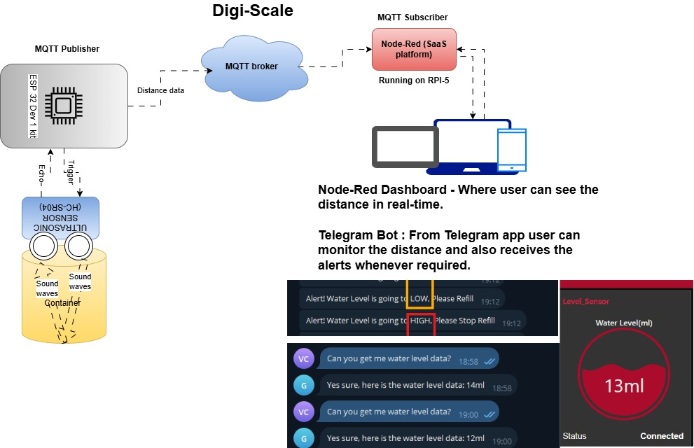
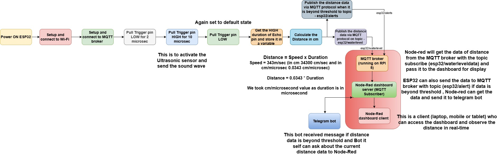
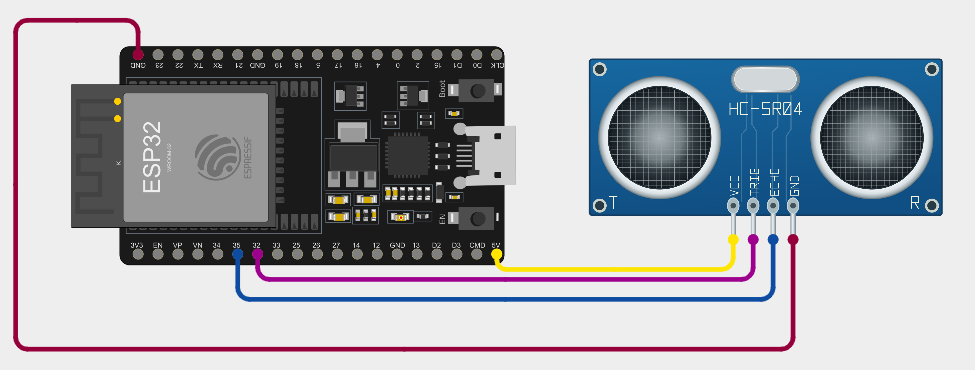
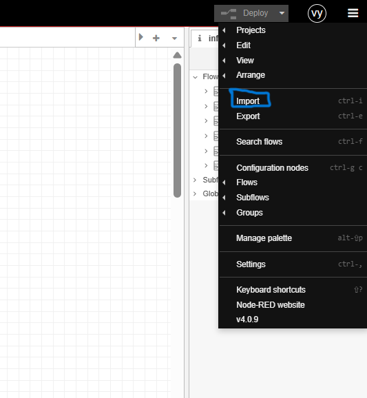
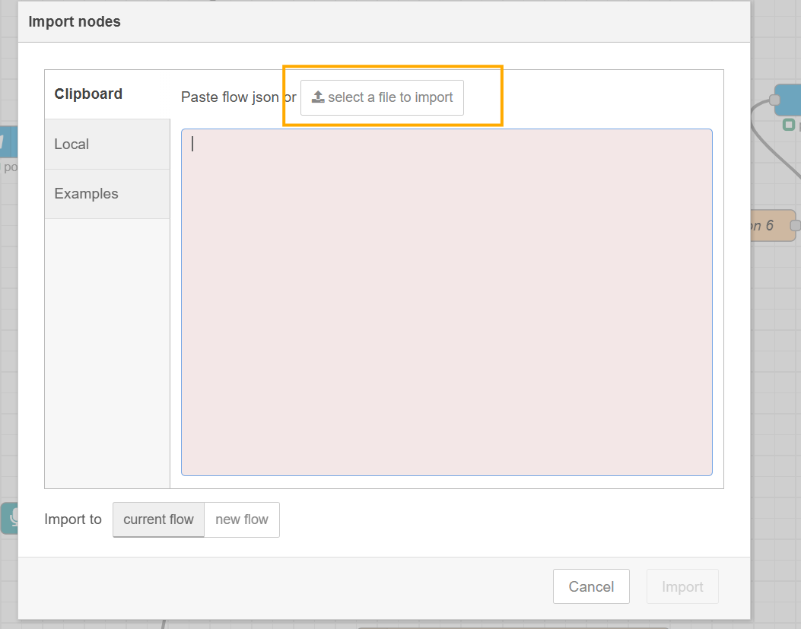
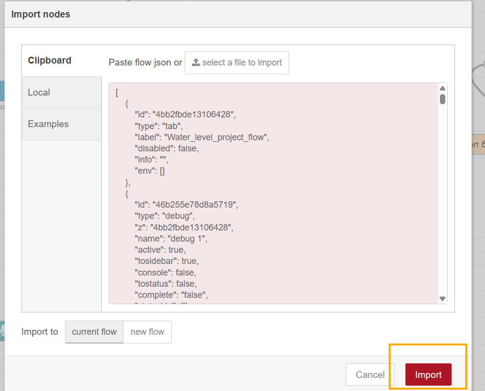
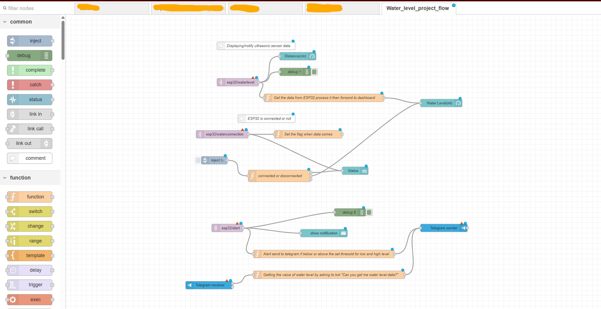
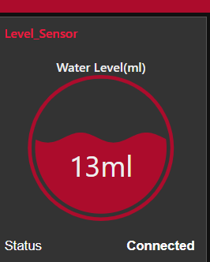
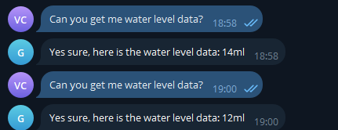
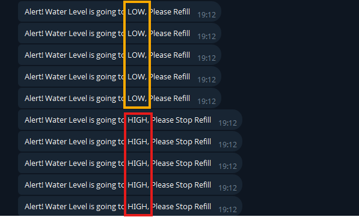

# Digi-scale
Digi-scale is used to monitor and give the alerts when scale value is beyond threshold in real-time

It is IoT based system that can measure Length/Height/Width of the product or object and send it to the dashboard and telegram bot via MQTT protocol with Low/High alerts when distance is beyond certain threshold.

## Observations

There are many observations in your day to day life that would tell you why this project is useful : 

### Observation 1 
> #### Re-filling the Water clay pot (Matka) from water filter takes time so, user started scrolling the reels or doing other work in parallel but the Pot get overflow and whole platform is full of water so, this is wasteage of water that I observed.
> #### If user can put the Digi-scale on top of the Pot then it can give alert to the user to turn OFF the water flow on Telegram or on Dashboard.

### Observation 2
> #### When suddenly guests comes to user's home and spices or veggies stocks are empty , nothing is there and also even if in quick commerce apps it is not available. So, I observed here that we have re-stock the things before it got empty. 
> #### if the Digi-scale device gives you an alert before time and you can re-stock the houshold kitchen products it would be easy in above situtions.

### Observation 3

> #### When you are travelling and your home is in the  renovation phase so, while choosing the size of the products like tiles, asthetic images, decorative things and customize furniture etc takes lots of time in video calls
> #### if the contractor uses the Digi-Scale for meauring size of products so, the owner can see the dashboard directly for size purpose and we can also store it for future use (storing a size in database will come in next release).

### In addtion to above three observation , there are lots of observation you did see in your daily life at home or in the industries while manufactoring the products.

## Overview of the project

#### This project is very simple and easy to understand. 
#### Basically it is an IoT based scale that can measure the Length, Height and width of any product via Ultrasonic sensor and send the data to Dashboard server via MQTT in real-time.

#### If the measurable parameters is beyond the certain thresold, it can send the alert message to telegram messanger via MQTT protocal and Telegram APIs.

#### This project automate the way of monitering the Length, Width and Height of the product and also the  ingredaints quantity that is inside of the measurable container. 

## Techincal details 

### Architecture Block Diagram

### Hardware components

>1. [ESP32 Dev 1 Kit](https://www.amazon.in/WROOM-32-Development-Bluetooth-Dual-Core-Microcontroller/dp/B0F9NZRZZQ/ref=sr_1_5?adgrpid=178781585994&dib=eyJ2IjoiMSJ9.ec76zUmzSkyeoXkeXxN5fzREf7dmk80iKGc4vrzlhYv7kaJxIsUE-yCdP1hWebSjtzlIB1BshJVvyIZT3ViA48VBUxBzOEmCQy3WuWhUweF0dSfFhD5X8REQqE6pXVjrx6orayXpyKf52Ld37apz62tjGOeNh4Zjy846Axr6b0hUjCGt7s8gP-fl2xmYDdicsRAbomrI6KrOVFqUfF2MOiqO-lVQ74XUF3jn09_bapg2Vwr8OfwAp9HeCzbzeRBGtvhia-rJDca_D_Yg3fk2GdU5Fhu59CZSKwpjFyV1d0w.91N5eqJ_6Ve3FAfKsmbg9sqmGfHidpHE6F5_UCKZM-M&dib_tag=se&ext_vrnc=hi&hvadid=735443541086&hvdev=c&hvlocphy=9061747&hvnetw=g&hvqmt=e&hvrand=6319756338202451833&hvtargid=kwd-2050083778771&hydadcr=26431_2762331&keywords=esp32+devkit+v1+price&mcid=e482543b69be33d098dd5344c8d9cbfa&qid=1761928583&sr=8-5) 
>2. [Ultrasonic Sensor-HC-SR04](https://robu.in/product/hc-sr04-ultrasonic-range-finder/)
>3. [Breadboard to connect ESP32 and Ultrasonic sensor](https://robu.in/product/solderless-400-pin-breadboard-normal-quality-without-packing/)
>4. [Raspberry PI 5](https://www.amazon.in/Raspberry-Pi-Cortex-A76-Computer-RPI5-4GB-SINGLE/dp/B0CK3L9WD3/ref=sr_1_3?crid=3M81959F7R4PO&dib=eyJ2IjoiMSJ9.iG3C_RhTcYByh-vruugjzlppu6kzBMatuV_q7eymZfjcGGUFASpjKC-uW5uYvZjc_r5oES37U-JF6S_0S6oLZTulyUow88EkLq86JSdKdZScLDUfbp2KPop3WZlQ1WZvEjxmsWhWoTgcSq60qUPKvg2DfXVgn0MgaCegnZRLjQzagYIOkiF8RP6ymHj7ADV-wbS-Y2B0UG538uKvfH_SG5CQv_8_u1cK0reUCb4UdZM.qm6_w2HO6J6RiMC4CgeJBY4zRsthVKE9ULSw564msdM&dib_tag=se&keywords=raspberry+pi+5&qid=1793530707&sprefix=Rasbe%2Caps%2C258&sr=8-3) / You can also use any Linux or Windows based machine if do not have a PI. 

### Software components 

>1. MQTT broker 
>2. Node-Red platform for dashboard server and MQTT subscriber
>3. ESP32 Firmware that measures distance and send data to broker

### System flow (ESP32 -> Dashboard / Telegram bot)

## Bring-up Steps 

### Pre-requist Steps : 
#### 1. **Install Platform IO IDE extention in VScode or used the Arduino IDE** - As this IDEs has the board libs and dependances.
#### 2. **Install Node-Red SaaS platform** refer **[Steps](https://nodered.org/docs/getting-started/raspberrypi)** - On PI or any debian based OS machine
> User can also install it on [Windows](https://nodered.org/docs/getting-started/windows) based machine if user do not have PI in hand or use the PI steps in debian based machine.
#### 3. **Install the MQTT broker** refer **[Steps](https://randomnerdtutorials.com/how-to-install-mosquitto-broker-on-raspberry-pi/)** - On PI
> User can also install it on [Windows](https://mosquitto.org/download/) based machine if user do not have PI in hand or use the PI steps in debian based machine.

Running MQTT broker on Windows if user does has Ubuntu or Raspbian based OS machine : 
> On windows after downloading the .exe file --> Install it (it will install in `C:\Program Files\Mosquitto\`)--> Generate the password using cmd line via mosquitto_pwd command same as Linux (mosquitto_pwd -c passwd username execue in cmd from path `C:\Program Files\Mosquitto\`), it will create a password file --> Add passwd file and other config in `C:\Program Files\Mosquitto\mosquitto.conf` file as below :   
> `listener	1883`   
> `listener_allow_anonymous	false`   
> `password_file	C:/Program Files/Mosquitto/passwd`  
> Then user can open the command line in a adminstrator mode and run the below commands to exeute the MQTT broker with the changes of config.  
> `cd "C:\Program Files\Mosquitto\"` #Go to the Mosquitto installation folder   
`mosquitto -c mosquitto.conf -v`     # Execute the broker with the config file  

>*Note : User can run the broker via service as well in Windows like an Ubuntu/Rasbian OS but there is some issue while reading the password file due to permission so, user need to set the permisson properly.*   

> Note : Make Sure MQTT broker is running in background either by service or normally by command before setting up the node-red

#### 4. **Create the Telegram bot from [here](https://github.com/vyomchanpura/Remote_pi#creating-telegrambot)** follow all the steps mention in the link and you are ready with your bot

### ESP 32 FW Steps : 
> #### The steps is same as Digital switch repo, please refer that steps [1-10](https://github.com/vyomchanpura/Digital_Switch/blob/main/Bring_up_Doc/Digital_Switch_ESP32_FW_bringup.md#digital-switch---esp32-firmware),  just take the source code for this project from [here](/Firmware/) 
> #### when you reach at the step 5 (Change SSID/password based on your Wifi router credentials and change the MQTT broker IP in the source code), then compile the code , connect the Ultrasonic sensor to ESP32 as mention below and upload the code as per mention in the Link.

### Components Connection

### Node-Red Setup on PI/Ubuntu or Windows based PC 
>Note : *Make Sure MQTT broker is running in background either by service or normally by command before setting up the node-red as here in step 6 user has to put Broker username and password*
#### 1. Install the Node-Red as mentioned in Pre-requist steps and make sure it is running in the background
#### 2. Open the web-interface of node-red for development in the browser by writing this address *http://nodeserver_ip:1880/*.
#### 3. Install the [UI-dashboard nodes](https://github.com/vyomchanpura/Digital_Switch/blob/main/Bring_up_Doc/Digital_Switch_RaspberryPI_setup.md#node-red---dashboard) and [Telegram node](https://github.com/vyomchanpura/Digital_Switch/blob/main/Bring_up_Doc/Digital_Switch_RaspberryPI_setup.md#node-red---telegram) by going to the 3 line at right corner --> Manage pallete --> Install as mentioned in the Links.
#### 4. Other nodes are already installed during Node-red installation.
#### 5. Now import the flow file (download it from [here](/Node_red_flow/Water_level_node_red_flow_eg.json) of this project by going to 3 line at right corner --> import and select the flow file.

#### 6. Change the config of MQTT nodes (add the broker username and password with broker IP) and also change the config of telegram bot by giving API token.
#### 7. Deploy the flow by clicking the deploy button (Red button) in the web-interface in the node-red server. 
#### 8. Open the dashboard UI with the URL : **<IPofnode-red_server>:1880/ui** 
#### 9. User can see the real-time distance of an object on to the dashboard.

#### 10. User can also ask for the real-time distance to telegram bot and bot will also gives alerts.

#### So, now systems are up with FW in ESP32 board, MQTT broker, telegram bot and node-red server on PI. User can use this end-to-end facality for various applications and use-cases.  

## Application / Use-cases
### Applications : 
> #### 1. Home / office Automation Industries
> #### 2. Automotive Industries 
> #### 3. Industrial Automation
> #### 4. Hospitality application
> #### 5. Grocery Shopping Industries

### Some Use-cases:
> #### 1. Digi-Scale is use to Remote monitering the water level (in Tank or Clay pot), the home grocery inventory, the meaurement of equepment (while doing furniture) via dashboard 
> #### 2. Digi-Scale is used to Automate the tap water flow and soap despener in office /malls washroom for touch less experince, Automate the office desk / path lights by meausring the people distance, remote moniter the water level of each of the water despenser so, admin can understand when to re-fill.    
> #### 3. It is used for those cars that has no inbuilt reverse and parking sensor 
> #### 4. Digi-Scale is very much useful in industries for level meauring remotly and moniter the process of making an product , it is also used in inventory monitering.
> #### 5. It is used for grocery monitering remotly at the retailer store so that shopkepper can prioritise the stock before it get over.

## Summary

#### In summary, Digi-Scale is a project where user can addon there applications based on the industries or there own requirements and customize the code based on the usecases.

#### Basic idea is to monitor or measure the distance from an object and display it on to the dashboard via MQTT protocol. Based on your requirement user can modify the code and write down the action they has perform as mention in Application / Use-case section.

#### It is like a measuring scale with remote monitering 

